# UI-Review November 2026 (APD-01)

Stand: 13.11.2026 · Paket APD-01 aus dem [Design-Arbeitsplan](../DESIGN-ARBEITSPLAN.md) · Grundlage für APD-02 ff.

**Worum es geht**: Die ganze Oberfläche der App wurde nach dem Prüfmaßstab des Design-Arbeitsplans durchgesehen –
Übersicht, Bedienbarkeit, Interaktion, Texte, Optik und Ausstrahlung, Einheitlichkeit, leere und Fehler-Zustände,
Tastatur, dunkles Design, Hoher Kontrast, kleine Fenster und Handy. Ziel des Hauptnutzers: Die App soll **super aussehen
und gut bedienbar sein** – ein rundes Gesamtprodukt mit einheitlichem Stil, seriös und modern, auf dem Niveau der neu
gezeichneten Lora (AP-122), ohne wie sie auszusehen. Die TU-Dresden-Vorlagen (Corporate Design) sind nicht Teil des
Reviews und bleiben unverändert; geprüft wurde nur die Oberfläche drumherum.

> **Nachtrag 13.11.2026**: Ein Teil der „abgeschnitten“-Befunde tritt nur im kleinen Review-Fenster (911 × 512 dp) oder in Handy-Breite auf, einige sind Testartefakte (US-Datum, Beispielschlüssel). Abgleich mit echten Fenstergrößen und Korrekturen: [Nachtrag](#nachtrag-abgleich-mit-echten-fenstergrößen-13112026).

**Inhalt**: [Methode](#methode) · [Gesamteindruck](#gesamteindruck) · [Noten je Bereich](#noten-je-bereich) ·
[Querschnitt](#q--querschnitt-alle-bereiche) · [Rahmen](#r--rahmen) · [Chat](#c--chat) · [Inhalte](#i--inhalte) ·
[Werkzeuge](#w--werkzeuge) · [Einstellungen](#e--einstellungen) · [Dunkel, Kontrast, Handy, Tastatur](#d--dunkel-hoher-kontrast-handy-tastatur) ·
[Grenzen](#grenzen-dieses-reviews) · [Stilrichtung](#stilrichtung-klar-ruhig-mit-lora-als-farbe) ·
[Pakete](#zuordnung-zu-den-paketen-apd-02-ff)

---

## Methode

- **Bilder aus einem Test**: `desktop/src/test/kotlin/io/github/thepytales/llmhub/ui/DesignReviewTest.kt` startet die
  echte App (`AppRoot`) mit eigenem Datenordner und führt sie durch alle Routen. Ergebnis: rund 300 Bilder in
  `desktop/build/design-review/<Konfiguration>/` (nicht eingecheckt; Aufruf
  `ADEU_DESIGN_REVIEW=1 ./gradlew -p desktop test --tests '*DesignReviewTest*'`, ca. 6 Minuten). Eine Auswahl liegt in
  [`bilder/`](bilder/).
- **Konfigurationen**: PC 1366 × 768 bei 150 % (911 × 512 dp, Hauptplattform) mit allen 54 Routen in ADEU hell und
  dunkel; breites Fenster 1600 × 900 dp; Handy-Breite 393 × 852 dp; TU Dresden und Hoher Kontrast (hell und dunkel) als
  Stichprobe; leer (kein Schlüssel, keine Daten), erster Start (Einrichtung) und mit Beispieldaten (zwei Projekte, acht
  Chats, ein Chat mit Antwort samt Liste, Tabelle, Zitat und Code, Dateien, Literatur, eine geplante Aufgabe; Editoren
  mit Dokument, Tabelle, Präsentation, Design und Whiteboard).
- **Handy**: gerendert ist die Desktop-Oberfläche in Handy-Breite (gemeinsamer Code in `app/src/main/java/…/ui`). Die
  Android-eigenen Teile (`MainActivity`, Navigation von Android, Systemleisten) sind damit nicht abgedeckt – siehe
  [Grenzen](#grenzen-dieses-reviews).
- **Code-Kennzahlen** (Ordner `ui/` beider Plattformen und `video/`): 331 feste Eckenradien in 18 Größen (2–32 dp),
  15 verschiedene Innenabstände, 28 feste Schriftgrößen (1–72 sp), **467 feste Farben** `Color(0x…)` in 41 Dateien,
  26 Bildschirme mit eigener `TopAppBar`, 49 Texte „Noch kein …“ in drei verschiedenen Mustern, 138 einzelne
  Ladeanzeigen. Es gibt **keinen** gemeinsamen Baustein für Seitenkopf, leeren Zustand, Lade-Zustand, Listenzeile oder
  Zustands-Hinweis.

**Noten** von 1 bis 5 wie in der Schule: 1 sehr gut · 2 gut · 3 befriedigend · 4 ausreichend · 5 mangelhaft; je
Bereich für **Übersicht** (finde ich mich zurecht, ist es aufgeräumt?), **Bedienung** (komme ich schnell und sicher ans
Ziel?) und **Ausstrahlung** (wirkt es seriös, modern, hochwertig – oder langweilig?).
**Schweregrad** wie im Design-Arbeitsplan: **hoch** (stört oder verwirrt im Alltag, Fehler, unlesbar), **mittel**
(umständlich, uneinheitlich, wirkt unfertig), **gering** (Feinschliff). **Aufwand**: S (bis 1 Tag), M (einige Tage),
L (1–2 Wochen).

---

## Gesamteindruck

**89 Befunde**: 23 hoch, 40 mittel, 21 gering, 5 Hinweise ohne Handlungsbedarf (gute Stellen) – davon 19 querschnittlich.

1. **Solides Fundament, aber kein Gesamtprodukt.** Die Bausteine aus AP-123 (Knöpfe, Dialoge, Felder, Schalter) sind
   einheitlich. Darüber baut aber jeder Bildschirm seinen eigenen Kopf, seine eigene Hauptaktion, seinen eigenen leeren
   Zustand und seine eigenen Farben – deshalb wirkt die App wie viele gute Einzelteile.
2. **Die Hauptplattform ist der schwächste Fall.** Bei 1366 × 768 und 150 % (911 × 512 dp) ist die Seitenleiste nie
   dauerhaft da (Schwelle 1000 dp), die Chat-Startseite blendet Aktionen, „Zuletzt“ und Loras Ideen aus (Schwelle 420 dp
   Höhe) und ist fast leer, die Willkommenskarte ohne Schlüssel ist abgeschnitten, der Gestalten-Editor bricht
   („Exportieren“ steht senkrecht Buchstabe für Buchstabe), der Dokument-Editor lässt für Text nur etwa ein Drittel der
   Höhe.
3. **Textwüsten statt visueller Anker.** Fast jede Seite beginnt mit einem Absatz Erklärung in kleiner grauer Schrift
   (Aufgaben, Umgebungen, Tresor, Modelle, Literatur, Videoeditor, die meisten Einstellungsseiten). Symbole, Farbe und
   Vorschauen fehlen dort, wo sie Orientierung geben würden (Dateien, Werkzeuge, PDF-Werkzeugkasten).
4. **Farbe sagt nicht dasselbe überall.** Rot steht auch für „noch nicht eingerichtet“ (Mail) und „Hinweis“ (Aufgaben);
   Dateien nutzt fest das TU-Dunkelblau für Knopf und Ordner – im dunklen Design und im Hohen Kontrast fast unsichtbar;
   der Sprachmodus-Knopf ist im violetten ADEU-Stil schwarz.
5. **Die besten Stellen zeigen den Weg.** Einrichtung (Schritte links, eine Frage je Schritt), Darstellung (Stil-Kacheln),
   Tabellen- und Folien-Editor, die leeren Zustände von Lernspiele, Stapel und Antrags-Werkstatt (Lora, Titel, ein Satz,
   Haupt- und Nebenknopf), Loras Seitenpanel im breiten Fenster. Diese Muster sollten die Regel für alle werden.
6. **Lora steht noch nicht gut da.** Sie erscheint in sechs Größen ohne Regel, schwebt schlafend über Feldern und Knöpfen,
   steht als Gesicht neben dem Modellnamen jeder Antwort (als hätte sie geantwortet) und ist auf der PC-Startseite ein
   kleines Symbol über viel Leere. Vor einer ruhigeren, klar gegliederten Oberfläche würde sie viel stärker wirken.

---

## Noten je Bereich

| Bereich | Übersicht | Bedienung | Ausstrahlung | Kurz |
| --- | :-: | :-: | :-: | --- |
| Einrichtung beim ersten Start | 2 | 2 | 2,5 | Gute Struktur; Fläche getönt, Lora klein |
| Seitenleiste | 3 | 3 | 3,5 | Am PC nur als Overlay; hohe Zeilen, Chats erst nach Scrollen |
| Strg+K und Tastenkürzel | 2,5 | 2 | 3,5 | Funktioniert; Liste ohne Symbole und Kürzel, getönte Fläche |
| Lora-Panel, schlafende Lora | 2,5 | 3 | 3 | Breit gut; am PC Blatt über dem Inhalt; schwebende Lora verdeckt |
| Chat-Startseite | 3,5 | 3 | 3,5 | PC fast leer; ohne Schlüssel abgeschnitten |
| Eingabefeld, Modellwahl | 3 | 2,5 | 3 | Groß, graue Kontext-Chips, schwarzer Knopf |
| Chat-Antworten | 2 | 2,5 | 2,5 | Gute Typografie; Lora am Modellnamen, Code am Handy abgeschnitten |
| Modellvergleich | 3,5 | 3 | 4 | Leere Spalten, eigenes Eingabefeld |
| Bilder erzeugen | 3 | 3 | 3,5 | Vorschläge hinter dem Eingabefeld |
| Dateien | 3 | 2,5 | 3,5 | Graue Liste, feste Farben, US-Datum, roher Pfad, kein leerer Zustand |
| Erstellen und TU Vorlagen (Oberfläche) | 4 | 3,5 | 3 | Überladen; am Handy zerbrochen |
| Dokument-Editor | 3 | 3 | 3 | Drei Leisten + Lineal, wenig Platz bei 1366 × 768 |
| Tabellen, Folien | 2 | 2 | 2 | Vertraut wie Office/Google |
| Gestalten (Design-Editor) | 4 | 4 | 3,5 | Bricht bei 1366 × 768: Export senkrecht, Seite winzig |
| Whiteboard und Diagramme | 4 | 3,5 | 3,5 | Zwei Chip-Reihen mischen Art, Werkzeug und Aktion |
| Scanner | 2 | 2 | 2,5 | Klarer Einstieg |
| Literatur | 3,5 | 3 | 3 | Startet mit langem Formular, Reiter über volle Breite |
| Transkription (Liste) | 2,5 | 2,5 | 3 | Guter leerer Zustand; deaktiviertes „Aufnehmen“ wirkt wie Fehler |
| PDF-Werkzeugkasten (Start) | 3 | 2,5 | 4 | Titel doppelt, Absatz statt Werkzeug-Übersicht |
| Tresor | 2,5 | 2,5 | 3 | Ordentlich; Aufzählung als Textpunkte |
| Lernspiele, Stapel, Antrags-Werkstatt | 2 | 2,5 | 2,5 | Vorbild für leere Zustände; Hauptaktion doppelt |
| Mail und Kalender | 3,5 | 3,5 | 4 | „Nicht verbunden“ als roter Absatz ohne Knopf |
| Videoeditor (Start) | 3,5 | 3 | 3 | Vier Muster auf einer Seite |
| Server-Terminal | 3 | 3 | 3 | Formular ok, Hauptknopf weit unten |
| Geplante Aufgaben, Umgebungen | 3,5 | 3 | 4 | Erklärtext oben, Hinweis rot, leer = nackter Text |
| Modelle, lokale Modelle | 4 | 3 | 3,5 | Rohe Fehlermeldung mit Token-Hash, Filter laufen ab, Wortbruch |
| Verbrauch | 3 | 3 | 3,5 | Viermal „0“, leeres Diagramm |
| Einstellungen – Übersicht | 2 | 2 | 2,5 | Gut gegliedert |
| Einstellungen – Seiten | 3,5 | 2,5 | 3 | Drei Aufbau-Muster, viel Fließtext |
| Dunkles Design | 2,5 | – | 2,5 | Gleichwertig bis auf feste Farben |
| Hoher Kontrast | 3 | – | 3 | Feste Farben und graue Chips unter AAA |
| Handy-Breite | 3,5 | 3 | 3 | Mehrere Brüche (Erstellen, Modelle), Filter abgeschnitten |

**Gesamt**: Übersicht 3,1 · Bedienung 2,8 · Ausstrahlung 3,2 – solide, aber noch nicht „super“.

---

## Q – Querschnitt (alle Bereiche)

| Nr | Befund | Ort im Code | Schwere | Vorschlag | Aufwand |
| --- | --- | --- | --- | --- | --- |
| Q-01 | **Kein gemeinsamer Seitenkopf.** 26 Bildschirme bauen eine eigene `TopAppBar`. Die Hauptaktion steht mal als Text-Knopf im Kopf („+ Neues Lernspiel“, „+ Neuer Antrag“, „+ Neuer Stapel“, „Erstellen“, „Speichern“ in Grau), mal als hellvioletter FAB unten rechts („Neue Aufgabe“, „Neue Umgebung“, „Neue Vorlage“), mal als großer dunkelblauer FAB (Dateien), mal gar nicht. Am Handy schneidet die Kopfaktion den Titel ab („Antrags-Wer…“). | `GamesScreen.kt:71`, `ProposalScreen.kt:106`, `BatchScreen.kt:102`, `EnvironmentsScreen.kt`, `TasksScreen.kt`, `TemplatesScreen.kt`, `DriveScreen.kt:1190` | hoch | Baustein `PageScaffold(title, subtitle, primary, actions, width)` in neuem `ui/Page.kt`: Titel links, ein Satz Untertitel, **Hauptaktion immer als gefüllter Knopf rechts im Kopf** (PC) bzw. erweiterter FAB unten (Handy, < 600 dp), Nebenaktionen als Symbol-Knöpfe mit Tooltip und ⋮. | M |
| Q-02 | **Kein gemeinsamer leerer Zustand.** Drei Muster: Lora + Titel + Satz + Knöpfe (Lernspiele, Stapel, Anträge, Videoeditor), Symbol-Kachel (Transkription, Bilder, Scanner), nackter Text (Umgebungen, Papierkorb, Messpunkte, Wissenssammlung, Projekte in der Seitenleiste) – und gar keiner (Dateien leer). | 49 Stellen „Noch kein…“, z. B. `EnvironmentsScreen.kt:83`, `DriveScreen.kt:1394` | hoch | Baustein `EmptyState(pose, title, text, primary, secondary)` in `ui/Design.kt`: Lora-Pose (passend zum Bereich, 96 dp), Titel, **ein** Satz, Hauptknopf, optional Nebenknopf, zentriert in Lesebreite. | M |
| Q-03 | **Textwüsten.** Seiten beginnen mit 3–6 Zeilen Erklärung in 12 sp Grau (Aufgaben, Umgebungen, Tresor, Modelle, Modelle auf diesem Gerät, Literatur-Agent, Videoeditor-Paket, Gedächtnis, Speicherorte, GitHub, Verbindungen, Werkzeuge). Wichtiges geht darin unter, die Seiten wirken langweilig. | viele Bildschirme | hoch | Ein Satz als Untertitel im Seitenkopf; Rest in zuklappbare Karte „So funktioniert es“ (einmal offen, dann zu) oder Info-Knopf (ⓘ) mit Popover. Texte auf ≤ 2 Zeilen kürzen (+ `i18n/en.tsv`). | M |
| Q-04 | **Lesebreite uneinheitlich.** Einstellungen haben 760 dp, Tresor, PDF und Mail stehen zentriert schmal – Aufgaben, Modelle, Dateien-Liste, Erstellen, Literatur-Reiter und Videoeditor laufen über die volle Breite (Zeilen bis 1500 dp im breiten Fenster). | `SettingsOverview.kt:112` (`ReadableColumn`), Einzelbildschirme | mittel | Breiten-Stufen im `PageScaffold`: LESEN (760), LISTE (1100), VOLL (Editoren). Reiter und Kopf an Inhaltsbreite ausrichten. | S |
| Q-05 | **Keine Abstands-, Ecken- und Schrift-Skala.** 18 Eckenradien (2–32 dp), 15 Innenabstände, 28 feste Schriftgrößen. Karten mal 12, mal 20 dp rund, Chips mal Pille, mal 8 dp. | alle `ui/`-Dateien | mittel | Tokens in `ui/Theme.kt`: `Space` (4, 8, 12, 16, 24, 32, 48), `Radius` (S/M/L je Stil aus `shapesOf`), Typo-Rollen (Seitentitel, Abschnitt, Kartentitel, Text, Hinweis). Test wie `ControlsBehaviourTest`, der neue feste Werte meldet. Umstellung schrittweise mit den Bildschirm-Paketen. | M |
| Q-06 | **Feste Farben statt Stil.** 467 `Color(0x…)` in 41 UI-Dateien. Dateien: FAB `#00305D`, Sonderordner `#00305D`, Ordner `#5F6B7A` – im dunklen Design und Hohen Kontrast dunkelblau auf Schwarz. | `DriveScreen.kt:775, 876, 881, 1191`, `FilesScreen.kt`, `TasksScreen.kt`, `TranscriptsScreen.kt` u. a. | hoch | Semantische Farben in `ChatLook` je Stil: `folder`, `fileKind(…)`, `star`, `areaTint(…)`, Zustände. Erlaubte Ausnahmen: Theme, Lora, Vorlagen-Vorschauen, Editor-Inhalte. Test, der neue Hex-Farben in Bildschirmen meldet. | M |
| Q-07 | **Zustandsfarben falsch eingesetzt.** „Noch kein Postfach verbunden“ als roter Absatz (Mail); „Dieser PC zeigt keine Benachrichtigungen“ mit rotem Fehler-Symbol (Aufgaben); deaktiviertes „Aufnehmen“ in Rosa (Transkription) sieht aus wie ein Fehler. | `MailScreen.kt:136`, `TaskDelivery.kt:38`, `TranscriptsScreen.kt` | hoch | Baustein `StatusBanner(tone = INFO/WARNUNG/FEHLER/ERFOLG, text, action)` mit Symbol; Rot nur für Fehler und Löschen. Deaktivierte Knöpfe neutral, Grund als Tooltip. | S |
| Q-08 | **Rohe technische Fehlermeldungen.** Modelle zeigt „HTTP 401 … Key Hash (Token) = c5714… LiteLLM_VerificationTokenTable“ – Interna und ein Schlüssel-Hash auf dem Bildschirm. | `ModelsScreen.kt:109` | hoch | `ErrorHelp` (vorhanden) überall nutzen: Klartext („Der Schlüssel wurde nicht angenommen“), Knopf „Schlüssel prüfen“, Details zugeklappt mit „Kopieren“. | S |
| Q-09 | **Datum und Uhrzeit nach Systemsprache.** „11/13/26, 6:02 PM“ in deutscher Oberfläche (Dateien, Aufgaben, Suche, Papierkorb). | `DriveScreen.kt:184`, `FilesScreen.kt:115`, `TasksScreen.kt:68` | mittel | `formatDate/formatTime` in `ui/I18n.kt` mit der Locale der App-Sprache; relativ, wo es hilft („heute, 18:02“, „gestern“). | S |
| Q-10 | **Schlafende Lora verdeckt Inhalte.** Unten rechts schwebend über Feldern (Literatur „Bis Jahr“), Schaltern (Einstellungen › Werkzeuge) und neben FABs („Neue Vorlage“) – am Handy ist die Ecke doppelt belegt. | `LoraHelper.kt:1147` (`LoraHelperButton`), `LORA_BUTTON_ROOM` | mittel | Lora wandert in den Seitenkopf („Frag Lora“-Pille wie im Chat, Strg+L) – die Ecke wird frei; schwebend nur noch auf Seiten ohne Kopf. | M |
| Q-11 | **Alles gleich laut.** Seitentitel, Kartentitel, Abschnittstitel und Beschriftungen sind alle fett; Abschnitte heißen mal „ZULETZT“ (Großbuchstaben), mal „Heute“ (grau), mal Kartentitel. | `Design.kt` (`GroupLabel`), Einzelbildschirme | mittel | Feste Typo-Rollen (Q-05); Abschnitte überall mit `GroupLabel`; Kartentitel 16 sp halbfett, Text normal. | S |
| Q-12 | **Einzelwahl in fünf Formen.** Segmente (Darstellung, Lora), zweites Segment-Aussehen (Neue Aufgabe „Uhrzeit \| Intervall“, „Je Bereich“), Radio-Listen (Gedächtnis, Stimme, Dokumente), Dropdown (Denkstufe, Zitierstil), vollbreiter Umriss-Knopf als Auswahl („Standardmodell: …“, „Modell: …“). | `Design.kt` (`Segmented`, `ChoiceField`), `ToolsSettings.kt`, `TasksScreen.kt` | mittel | Regel: 2–3 kurze Optionen → `Segmented`; 3–6 mit Erklärung → `RadioCards`; viele → `ChoiceField`; Modell → `ModelField` (Name + Ort-Symbol). | M |
| Q-13 | **Knopf-Hierarchie.** Zwei gefüllte Hauptknöpfe in einer Karte (Willkommen), Text-Links und Umriss-Knöpfe gemischt in derselben Liste (Inhalte zum Nachladen: „Laden“ vs. „Öffnen“), Link „Statusseite öffnen“ unter Umriss-Knopf. | `Welcome.kt`, `VocabularyUi.kt` (Downloads), `SettingsScreen.kt` (`ApiSection`) | mittel | Höchstens **ein** gefüllter Knopf je Bereich; Nebenaktionen umrandet; Links nur im Fließtext. | S |
| Q-14 | **Filter laufen unsichtbar ab.** Waagerecht scrollende Chip-Reihen ohne Hinweis („Evaluati…“, „L…“) in Modelle, Dateien (Handy), TU Vorlagen. | `ModelsScreen.kt`, `DriveScreen.kt:599`, `TemplatesScreen.kt` | mittel | Rand-Verlauf + Bildlaufleiste (AP-123 `Scrollbars`) oder `FlowRow` mit „Weitere Filter ▾“. | S |
| Q-15 | **Keine Zonen.** Seitenleiste und Inhalt haben dieselbe Fläche, nur eine Linie trennt; Köpfe beider Spalten liegen auf verschiedener Höhe. | `AppDrawer.kt` (`drawerContainerColor = background`), `desktop/…/AppRoot.kt` | mittel | Seitenleiste eine Stufe dunkler (`surfaceContainerLow`), Inhalt als helles Blatt; gemeinsame Kopfhöhe 56 dp. | S |
| Q-16 | **Zwei Flächen-Welten.** Dialoge (Strg+K, Tastenkürzel, Einrichtung) sind durch `tonalElevation` lavendelfarben getönt, Karten sonst weiß. | `SetupWizard.kt:108`, `CommandPalette.kt` | gering | Dialoge auf `look.card` mit Schatten und Rahmen wie Menüs. | S |
| Q-17 | **Wörter brechen mitten im Wort.** „DeepSee / k V4.1 / Flash“ (Modelle am Handy), „D / i / a / g“ (Erstellen am Handy), „E / x / p / o / r / t / i / e / r / e / n“ (Gestalten-Editor am PC). | `ModelsScreen.kt`, `CreateUi.kt`, `DesignEditor.kt` | hoch | Mindestbreiten, `softWrap` nur zwischen Wörtern, Kopfleisten umbrechen statt quetschen; Look-Test, der senkrechte Texte erkennt (Breite eines Textes < 2 Zeichen). | S |
| Q-18 | **Laden ohne Satz.** 138 einzelne Fortschrittsanzeigen, meist ohne Text. | viele | gering | `LoadingState(text)` und Platzhalter-Zeilen für Listen. | S |
| Q-19 | **Lora ohne Regel.** Sechs Größen und Posen (24 dp im Antwortfuß, 48 in leeren Zuständen, 72–132 auf der Startseite, 56 schwebend schlafend …); als Gesicht neben dem Modellnamen jeder Antwort und im KI-Panel des Editors („Lora · DeepSeek V4.1 Flash“). | `ChatMessages.kt:673`, `ChatScreenParts.kt`, `DocsAssistant.kt` | mittel | Regel: Lora nur, wo Lora spricht oder hilft (Startseite, Panel, Einrichtung, leere Zustände, Erfolg); drei Größen (32 / 96 / 160 dp). Modelle bekommen ein neutrales Symbol. | S |

## R – Rahmen

| Nr | Befund | Ort im Code | Schwere | Vorschlag | Aufwand |
| --- | --- | --- | --- | --- | --- |
| R-01 | **Seitenleiste am PC nur als Overlay.** Bei 1366 × 768 @ 150 % ist das Fenster 911 dp breit; die Seitenleiste bleibt erst ab 1000 dp stehen – auf der Hauptplattform ist sie also nie sichtbar, Wechsel zwischen Chats kostet immer zwei Klicks. | `desktop/…/ui/AppRoot.kt` (`maxWidth >= 1000.dp`) | hoch | Schwelle auf 840 dp; Seitenleiste dort 260 dp; zwischen 600 und 840 dp eine Symbol-Leiste (Rail) mit den Bereichen. | M |
| R-02 | **Zeilen zu hoch, Chats zu weit unten.** Bereiche je ≈ 48 dp; bei 512 dp Höhe füllen Logo, „Neuer Chat“, vier Bereiche und „Mehr“ die Leiste – Projekte und Chats erst nach Scrollen. | `AppDrawer.kt` (`NavRow`, `AreaRow`) | hoch | Kompakte Zeilen (36–40 dp), Bereiche als Gruppe, Chats mit Datumsgruppen gleich sichtbar. | S |
| R-03 | **„Neuer Chat“ ist kein Knopf.** Nur fetter Text mit Symbol – die wichtigste Aktion der App sieht aus wie ein Menüpunkt. | `AppDrawer.kt:298` (`nav_new`) | mittel | Umrandeter oder gefüllter Knopf „Neuer Chat“ mit Kürzel Strg+N. | S |
| R-04 | **Projektnamen gekürzt trotz Platz.** „Lehrinno… 1 ⌄ ⋮“ – Zähler, Pfeil und Menü nehmen die Breite. | `AppDrawer.kt:590` (`FolderRow`) | mittel | Menü nur bei Hover/Fokus, Zähler als kleine Marke, Pfeil links. | S |
| R-05 | **Abschnittstitel uneinheitlich.** „Projekte“, „Heute“, „Letzte 7 Tage“ in Grau normal; auf der Startseite „ZULETZT“ in Großbuchstaben. | `AppDrawer.kt:486` (`SectionTitle`) | gering | `GroupLabel` überall. | S |
| R-06 | **Markenname doppelt.** Logo + „Lora“ in Überschrift-Größe oben, „Frag Lora“-Pille rechts im Chat-Kopf, Lora auf der Startseite. | `AppDrawer.kt` (Kopf) | gering | Kopf der Leiste kleiner (Logo 28 dp + Name 18 sp), Suche als Feld statt Symbol. | S |
| R-07 | **Strg+K wirkt roh.** Getönte Fläche, Einträge ohne Symbole und ohne Kürzel, Suchfeld-Platzhalter zweizeilig. | `CommandPalette.kt` | mittel | Symbol je Eintrag (wie Seitenleiste), Kürzel rechts, Gruppen als `GroupLabel`, weiße Fläche, Platzhalter kürzer. | S |
| R-08 | **Tastenkürzel-Übersicht** einspaltig, ohne Gruppen, Tasten als graue Kästen. | `CommandPalette.kt:257` | gering | Gruppen (Navigation, Chat, Ansicht), Tasten als Keycaps, zweispaltig ab 700 dp. | S |
| R-09 | **Lora-Panel am PC als Blatt über dem Inhalt.** Unter 1000 dp kommt Loras Panel von unten über Chat und Eingabefeld; Begrüßung drei Zeilen. | `desktop/…/AppRoot.kt` (`LoraSheet`), `LoraHelper.kt` | mittel | Ab 840 dp Seitenpanel wie im breiten Fenster; Begrüßung ein Satz. | S |
| R-10 | **Durchgestrichenes Auge im Chat-Kopf** (temporärer Chat) ist ohne Beschriftung unverständlich. | `ChatScreen.kt:443` | mittel | Ins ⋮-Menü „Temporärer Chat“ oder Symbol mit Text-Tooltip und Kürzel. | S |
| R-11 | **Einrichtung**: klare Schrittliste, gute Texte; Fläche lavendel getönt, Lora klein, erledigte Schritte ohne Haken. | `SetupWizard.kt` | gering | Weiße Fläche (Q-16), Lora 96 dp im Willkommen, Haken an erledigten Schritten. | S |
| R-12 | **Startanimation** nicht bebildert (im Test aus). Laut Code respektiert sie *Ruhigere Bewegungen*. | `Logo.kt:133` | – | Im Bewegungs-Paket mitprüfen. | – |

## C – Chat

| Nr | Befund | Ort im Code | Schwere | Vorschlag | Aufwand |
| --- | --- | --- | --- | --- | --- |
| C-01 | **PC-Startseite fast leer.** Bei 512 dp Höhe bleiben über dem Eingabefeld ≈ 330 dp: Startaktionen (ab 420 dp), „Zuletzt“ (ab 600 dp) und Loras Ideen (ab 380 dp) entfallen. Übrig: kleine Lora, Gruß, Modellzeile, viel Weiß – genau „langweilig“. 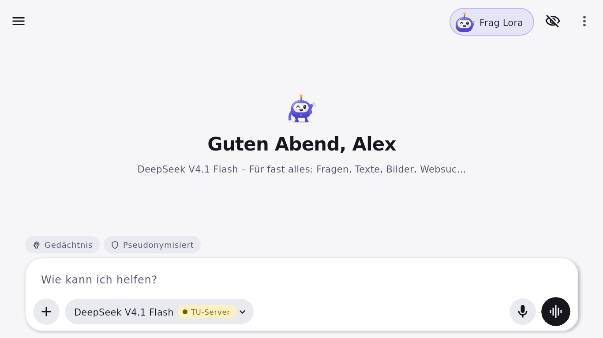 | `ChatScreenParts.kt:150–153` (`bubble`, `roomForTiles`, `roomForLists`) | hoch | Kompaktes Layout statt Ausblenden: Lora 96 dp links neben Gruß und einem Satz; eine Reihe Startaktionen; „Weiter, wo du warst“ als drei Karten; Eingabefeld in die Mitte gerückt. Siehe Entwurf. | M |
| C-02 | **Ohne Schlüssel am PC abgeschnitten.** Die Willkommenskarte zeigt nur Titel und „Lora Schritt für Schritt einrichten“ – Schritte, „API-Key eintragen“ und „alles auf diesem Gerät“ sind weg, ohne Bildlauf. 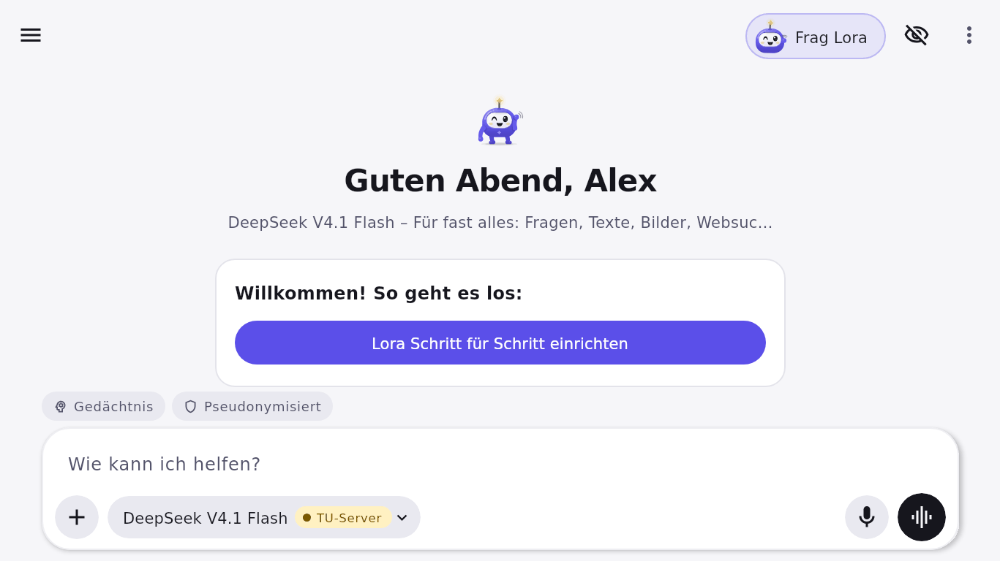 | `Welcome.kt`, `ChatScreenParts.kt:181` | hoch | Karte scrollbar oder kompakt: ein Hauptknopf „Einrichten“, zwei Nebenwege als Zeilen. | S |
| C-03 | **Modellzeile doppelt.** Unter dem Gruß „DeepSeek V4.1 Flash – Für fast alles: …“ (abgeschnitten), dasselbe Modell steht im Eingabefeld. | `ChatScreenParts.kt:170` | gering | Entfernen; Beschreibung als Tooltip der Modellwahl. | S |
| C-04 | **Kontext-Chips wirken deaktiviert.** „Gedächtnis“ und „Pseudonymisiert“ grau über jedem Eingabefeld, kosten 40 dp Höhe. Im Hohen Kontrast kontrastarm. | `ChatComposer.kt:77` (`ContextChip`), `ChatScreen.kt:616` | mittel | Als kleine Status-Symbole in die Eingabeleiste (Schild, Gedächtnis) mit Tooltip; farbig nur, wenn aktiv. | S |
| C-05 | **Eingabefeld zu mächtig, Knopf fremd.** ≈ 130 dp hoch (ein Viertel der PC-Höhe); Sprachmodus-Knopf schwarz (Standard von `ChatLook.action`), Akzent sonst violett; Mikrofon und Sprachmodus nebeneinander mit ähnlichen Symbolen. | `ChatComposer.kt:277–291`, `Theme.kt` (`ChatLook.action`) | mittel | Höhe 96 dp im Ruhezustand; Senden/Sprachmodus im Akzent des Stils; ein Mikrofon mit Menü (Diktat / freihändig). | S |
| C-06 | **Modellwahl-Pille abgeschnitten.** Am Handy „DeepS… ● TU-Server“; gelbe TU-Server-Marke in jeder Eingabeleiste. | `ChatComposer.kt` | mittel | Ort als kleines Symbol vor dem Namen; Name hat Vorrang. | S |
| C-07 | **Lora am Modellnamen der Antwort.** Neben „DeepSeek V4.1 Flash“ steht Loras Gesicht – als hätte Lora geantwortet; ebenso im KI-Panel des Editors. 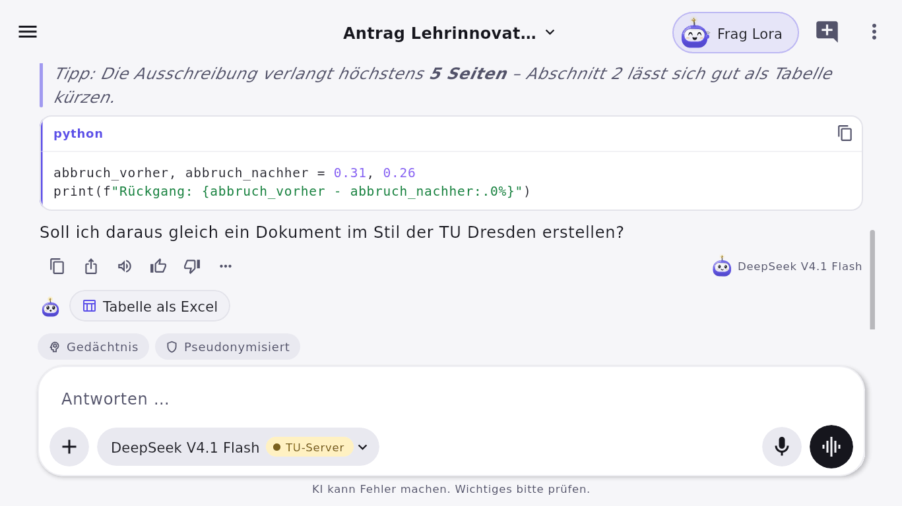 | `ChatMessages.kt:673`, `DocsAssistant.kt` | mittel | Neutrales Modell-Symbol (Anbieter-Initiale); Lora nur bei ihren Vorschlägen. | S |
| C-08 | **Code am Handy abgeschnitten**, ohne Bildlaufleiste; Tabellen haben einen Pfeil – zwei Muster. 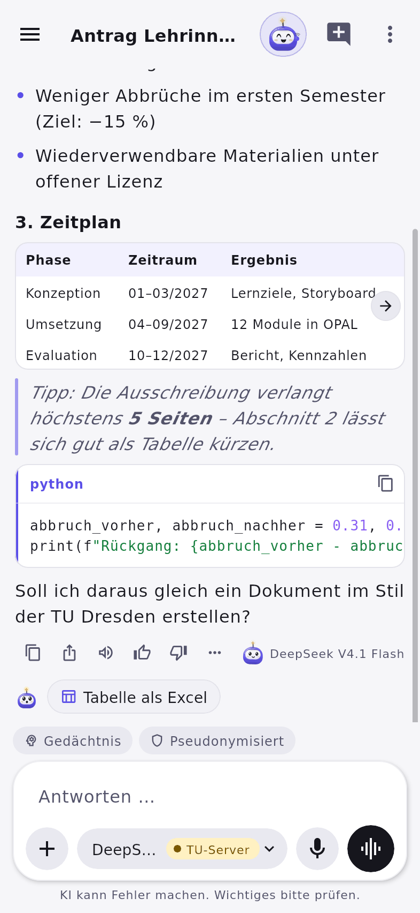 | `Markdown.kt` | mittel | Beide mit Rand-Verlauf und Bildlaufleiste; Code optional umbrechen. | S |
| C-09 | **Chat-Titel gekürzt** („Antrag Lehrinnovat…“), obwohl rechts Platz ist; zentriert zwischen Menü und Pille. | `ChatScreen.kt:409–431` | mittel | Titel linksbündig, nimmt die Restbreite; Pfeil für das Chat-Menü bleibt. | S |
| C-10 | **Antworten**: angenehme Lesebreite und Typografie; Zitat-Balken und Code-Kasten mit Akzentstreifen passen. | `Markdown.kt`, `Design.kt` (`AccentBox`) | – | Beibehalten, als Vorbild für Karten im Rest der App. | – |
| C-11 | **Modellvergleich**: leere Spalten mit Beschreibung in der Mitte, eigenes graues Eingabefeld statt Chat-Eingabe, keine Startbeispiele. 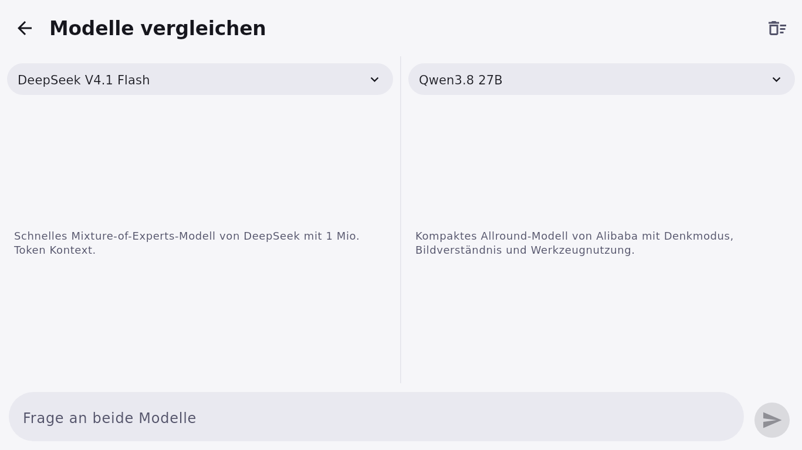 | `CompareScreen.kt:178` | mittel | Gleiches Eingabefeld wie im Chat; leere Spalten als Modellkarte (Stärken, Tempo, Ort) + drei Beispiel-Fragen. | M |
| C-12 | **Bilder erzeugen**: Vorschläge rutschen hinter das Eingabefeld; Optionen als vier Chips („Ohne Stil“, „1024 × 1024“, „1 Bild“, „Standard“) sehen aus wie Filter. 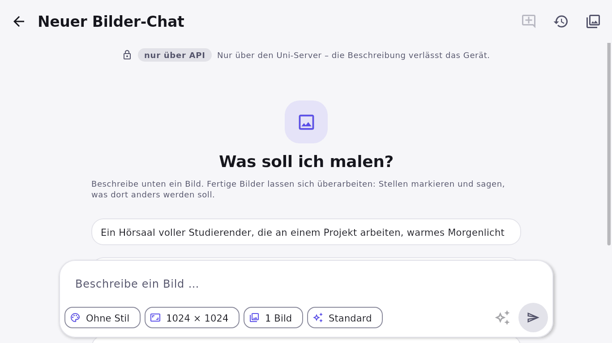 | `ImagesScreen.kt:273` | mittel | Vorschläge mit Abstand über dem Eingabefeld (oder als Raster mit Beispielbildern); Optionen in einem „Einstellungen“-Menü mit Zusammenfassung. | S |
| C-13 | **Fußnote „KI kann Fehler machen“** gut platziert. | `ChatScreen.kt:585` | – | – | – |

## I – Inhalte

| Nr | Befund | Ort im Code | Schwere | Vorschlag | Aufwand |
| --- | --- | --- | --- | --- | --- |
| I-01 | **Dateien: graue Liste ohne Anker.** Ordner und Dateien sehen gleich aus (graues Symbol, Name, „Geändert … · 0 Einträge“), keine Spalten am PC, keine Vorschau.  | `DriveScreen.kt:846, 876` | mittel | Listenzeile mit Typ-Kachel (Farbe je Dateityp), Spalten Name · Geändert · Größe am PC, Vorschaubilder in der Raster-Ansicht, „Zuletzt“ als Karten-Reihe oben. | M |
| I-02 | **Dateien: feste Farben** (FAB `#00305D` 72 dp, Ordner `#5F6B7A`) – in ADEU fremd, im Dunkeln und Hohen Kontrast fast unsichtbar. 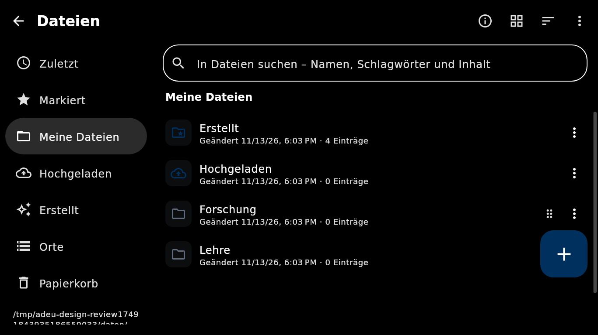 | `DriveScreen.kt:881, 1191` | hoch | Q-06; Hauptaktion „Neu“ in den Seitenkopf (Q-01). | S |
| I-03 | **Roher Pfad in der Seitennavigation** („/tmp/adeu-design-review…/daten/Lora“, umgebrochen, abgeschnitten). | `DriveScreen.kt:585` (`loraFolderLabel()`) | mittel | „Ort: Dokumente › Lora“ mit Ordnersymbol, voller Pfad im Tooltip, Klick öffnet den Ordner. | S |
| I-04 | **Dateien leer ohne leeren Zustand** – nur „Erstellt“ und „Hochgeladen“ mit 0 Einträgen. 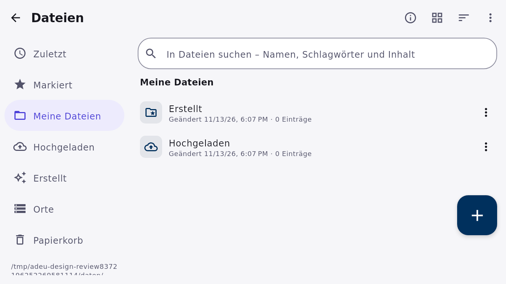 | `DriveScreen.kt:1394` (`EmptyHint`) | hoch | `EmptyState`: „Hier landen deine Dateien“ – Hochladen, Neues Dokument, Ordner freigeben; Ablegen-Fläche. | S |
| I-05 | **Ziehgriff (⠿) nur bei manchen Ordnern** sichtbar – wirkt zufällig. | `DriveScreen.kt` (eigene Ordner) | gering | Nur bei Hover/Fokus. | S |
| I-06 | **„Erstellt“ doppelt** (Ordner in „Meine Dateien“ und Abschnitt in der Navigation). Am Handy Suchfeld zweizeilig, Filter abgeschnitten. 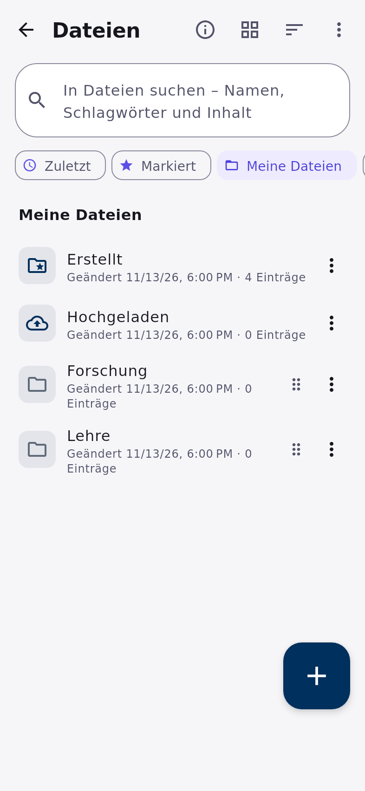 | `DriveScreen.kt:152` | mittel | Abschnitt „Von Lora erstellt“; Platzhalter „Dateien durchsuchen“. | S |
| I-07 | **Erstellen am Handy zerbrochen**: Hinweis einwortig untereinander, Beschreibung von „Gestalten“ gequetscht, Überschrift „Diagramme“ Buchstabe für Buchstabe; schwebende Lora und „Neue Vorlage“ belegen die Ecke. 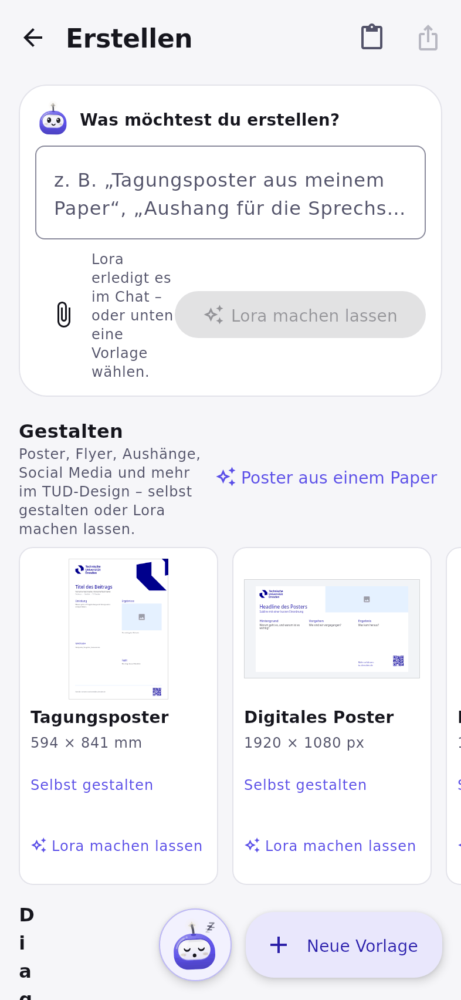 | `CreateUi.kt:83`, `TemplatesScreen.kt` | hoch | Zeilen umbrechen statt nebeneinander quetschen (`FlowRow`/Spalte unter 600 dp). | S |
| I-08 | **Erstellen überladen**: Prompt-Karte, Galerie, Diagramm-Chips, TU-Vorlagen-Suche, Filter-Chips, Liste – alles auf einer Seite; jede Galerie-Karte hat zwei Text-Links („Selbst gestalten“, „Lora machen lassen“). | `TemplatesScreen.kt`, `CreateUi.kt` | hoch | Abschnitts-Reiter (Gestalten · Diagramme · TU Vorlagen · Eigene) oder Sprungmarken; Karte mit **einer** Hauptaktion (Klick) und Menü; Galerie mit Pfeilen/Leiste. | M |
| I-09 | **Kopf-Symbole unklar** (Klemmbrett, ausgegrautes Teilen). | `TemplatesScreen.kt` | gering | Beschriftete Aktionen im ⋮-Menü. | S |
| I-10 | **Gestalten-Editor bricht bei 1366 × 768**: „Exportieren“ senkrecht über die halbe Höhe, Seite winzig, Titel als großes Feld in der Leiste. 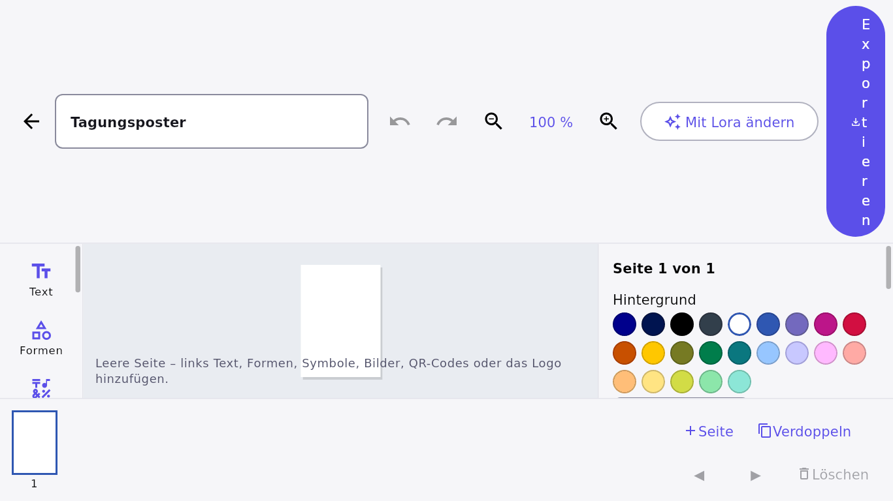 | `desktop/…/ui/DesignEditor.kt` | hoch | Kopfleiste: Titel als Text (Klick = umbenennen), Export als Knopf mit Text nur ab 1000 dp, sonst Symbol; Eigenschaften als ausklappbare Spalte. | S |
| I-11 | **Dokument-Editor wenig Schreibfläche**: Reiter, Menüleiste, Formatleiste und Lineal ≈ 190 dp; „Mit KI schreiben“ schwebt über dem Text. 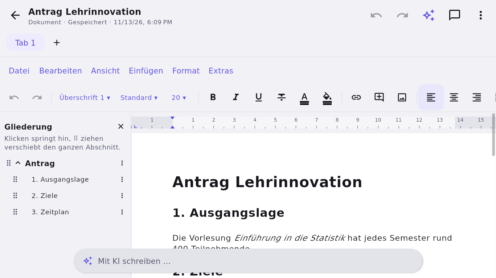 | `FlowEditor.kt`, `DocsEditor.kt`, `FlowTabs.kt` | mittel | Menü und Formatleiste in eine Zeile, Lineal einklappbar, Reiter-Leiste nur bei > 1 Tab; KI-Leiste unten angedockt. | M |
| I-12 | **Tabelle im Dokument** als einzelne Kästen mit Lücken statt Gitter. | `FlowEditor.kt` (Tabellen-Block) | mittel | Durchgehendes Gitter wie in der Tabellen-App. | S |
| I-13 | **Whiteboard**: zwei Chip-Reihen mischen Art (Flussdiagramm, Mindmap …), Werkzeug (Auswählen, Verbinden, Stift, Notizzettel) und Aktion (Automatisch anordnen, Mermaid-Text, +, −); „Rückgängig“ als grauer Text; Titel als Feld. 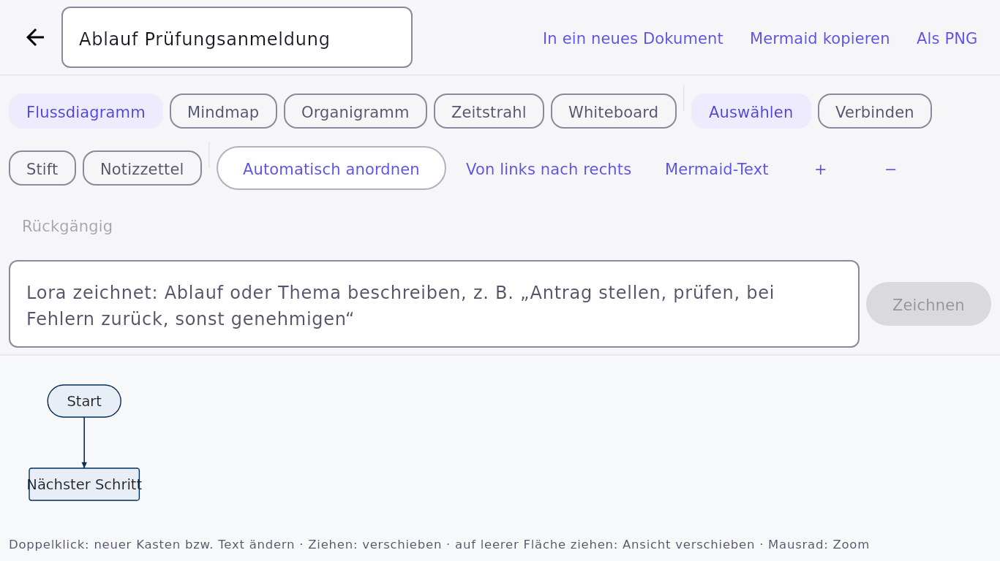 | `desktop/…/ui/WhiteboardScreen.kt`, `DiagramEditor.kt` | hoch | Werkzeugleiste links (Symbole), Art als `ChoiceField`, Aktionen im Kopf; Lora-Prompt als ausklappbare Leiste. | M |
| I-14 | **Tabellen- und Folien-Editor** wirken vertraut und aufgeräumt. | `SheetEditor.kt`, `SlidesEditor.kt` | – | Vorbild für die Leisten der anderen Editoren. | – |
| I-15 | **Scanner** leer: Symbol, Satz, Knopf, Tipp – klar. | `ScanScreen.kt:321` | gering | In `EmptyState` überführen (Lora mit Scanner-Pose). | S |
| I-16 | **Literatur startet mit Formular** (Thema, Kontext, Jahre, Sprachen, Arten, Datenbanken), auch wenn die Sammlung schon Einträge hat; Reiter über die volle Breite, Inhalt schmal. | `LiteratureScreen.kt` | mittel | Startreiter „Sammlung“, sobald es Einträge gibt; Suche als eine Zeile + „Erweitert“; Reiter an Inhaltsbreite. | M |

## W – Werkzeuge

| Nr | Befund | Ort im Code | Schwere | Vorschlag | Aufwand |
| --- | --- | --- | --- | --- | --- |
| W-01 | **PDF-Werkzeugkasten**: Titel doppelt (Kopf und Inhalt), sechs Zeilen Fließtext, ein Knopf – die Werkzeuge selbst sieht man nicht. 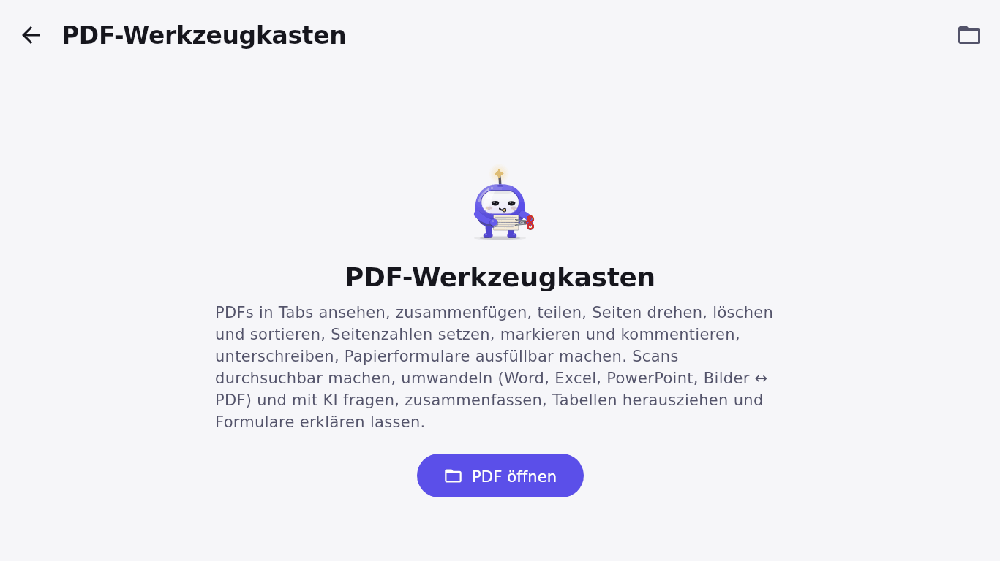 | `PdfToolScreen.kt` | hoch | Raster der Werkzeuge als Kacheln (Zusammenfügen, Teilen, Unterschreiben, Texterkennung, Umwandeln, Formular) + Ablagefläche „PDF hierher ziehen“. | M |
| W-02 | **Transkription**: leerer Zustand gut; „Aufnehmen“ deaktiviert in Rosa (Q-07); Fehlerkarte mit rotem Symbol ist hier richtig. 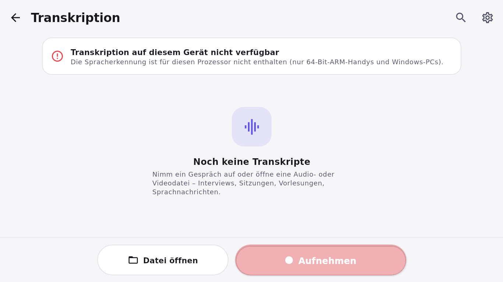 | `TranscriptsScreen.kt:225` | mittel | Deaktiviert neutral + Grund; Karte als `StatusBanner`. | S |
| W-03 | **Tresor**: Vorteile als Textpunkte „•“, PIN-Formular ordentlich. | `VaultScreen.kt` | gering | Drei Vorteile mit Symbolen, Schild-Illustration. | S |
| W-04 | **Lernspiele, Stapel, Antrags-Werkstatt**: einheitlicher leerer Zustand mit Lora – gut; Hauptaktion aber doppelt (Kopf „+ Neues Lernspiel“ und Knopf „Lernspiel bauen lassen“) und mit verschiedenen Wörtern. 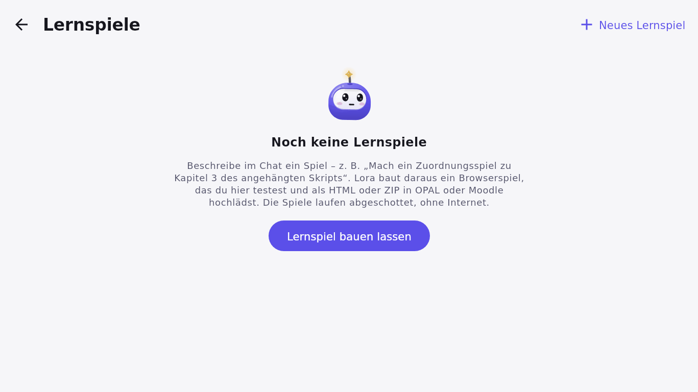 | `GamesScreen.kt:71`, `BatchScreen.kt:102`, `ProposalScreen.kt:106` | gering | Muster als `EmptyState` übernehmen; Kopfaktion nur, wenn die Liste nicht leer ist. | S |
| W-05 | **Mail und Kalender**: „nicht verbunden“ als roter Absatz ohne Knopf; Handy zeigt statt Titel nur „Mails \| Übersicht“. 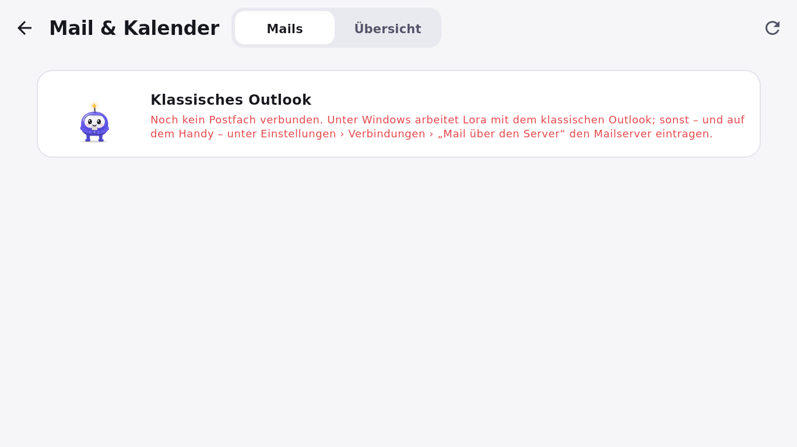 | `MailScreen.kt:136` | hoch | `EmptyState` „Postfach verbinden“ mit „Outlook nutzen“ und „Mailserver eintragen“; Titel bleibt, Umschalter darunter. | S |
| W-06 | **Videoeditor**: Einrichtungskarte (Fließtext), zwei Startkarten, vier Schritt-Punkte und ein leerer Zustand – vier Muster auf einer Seite. 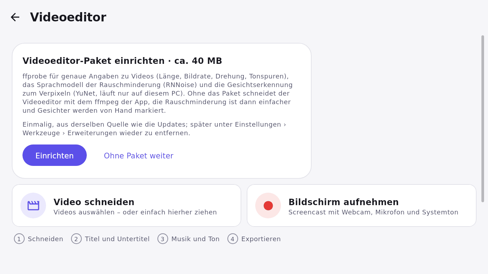 | `desktop/…/video/VideoScreen.kt` | mittel | Zwei große Start-Kacheln + Paket-Hinweis als `StatusBanner`; Projektliste darunter. | M |
| W-07 | **Server-Terminal**: Formular zweispaltig gut; „Verbinden“ und „Speichern“ deaktiviert ganz unten; Erklärtext in der Sitzungsspalte. | `desktop/…/ui/ServerTerminalScreen.kt` | mittel | Hauptknopf im Kopf/oben, Sitzungen als Karten, Erklärung als Untertitel. | S |
| W-08 | **Geplante Aufgaben**: Erklärtext oben, Hinweis mit rotem Symbol, Karte mit Schalter-Haken, Rohwert „· m“, US-Datum, „Jetzt ausführen“ als Link; „Neue Aufgabe“: „Speichern“ grau oben rechts, Modell als vollbreiter Umriss-Knopf, eigener Segment-Look. 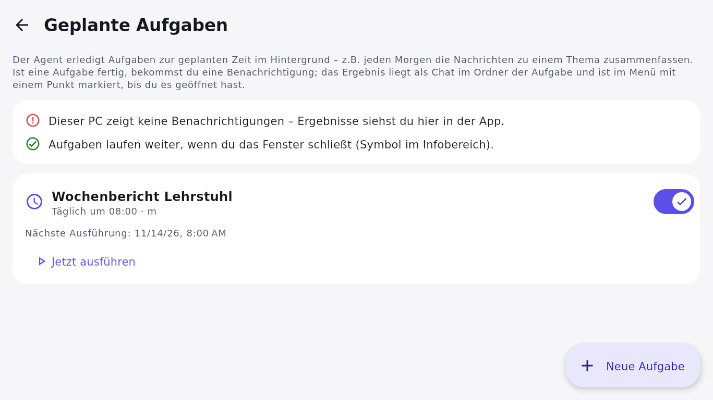 | `TasksScreen.kt`, `TaskDelivery.kt:38` | mittel | Seitenkopf mit Untertitel; Karte: Name, Zeitplan als Satz („Werktags um 8:00“), nächster Lauf relativ, Aktionen als Knöpfe; Formular mit Haupt-Knopf unten. | M |
| W-09 | **Umgebungen**: leer als nackter Text, Erklärung mit „${NAME}“; „Erstellen“ als Text-Aktion im Kopf. 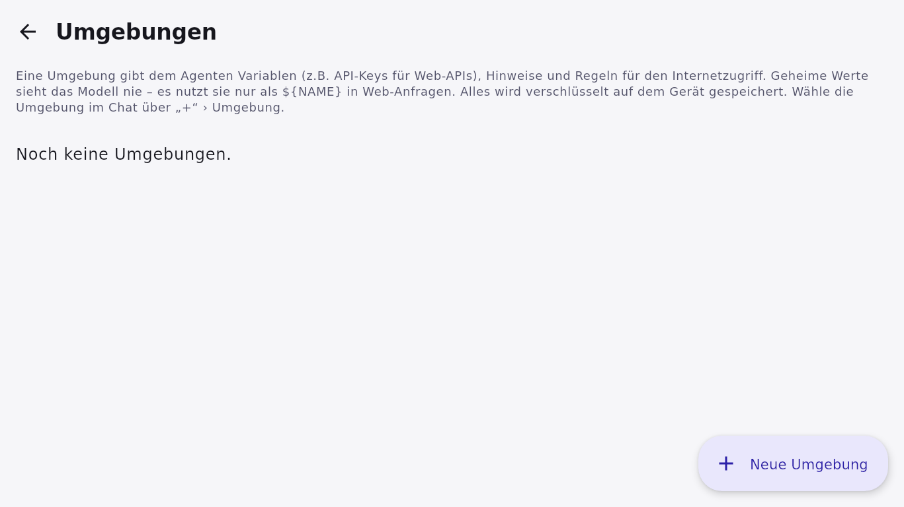 | `EnvironmentsScreen.kt:83` | mittel | `EmptyState`; Fachbegriffe in die Hilfe. | S |
| W-10 | **Verbrauch**: viermal „0“, leeres Diagramm, Kürzel „7 T/14 T/30 T“, Papierkorb-Symbol ohne Text. | `UsageScreen.kt` | gering | Leerer Zustand „Noch keine Anfragen“; Zeitraum als `Segmented` „7 Tage“; Löschen im ⋮-Menü. | S |
| W-11 | **Modelle**: rohe Fehlermeldung (Q-08), zwei Filter-Reihen mit 19 Chips, Karten mit fünf Textzeilen, Chips und Balken; am Handy Wortbruch im Namen. 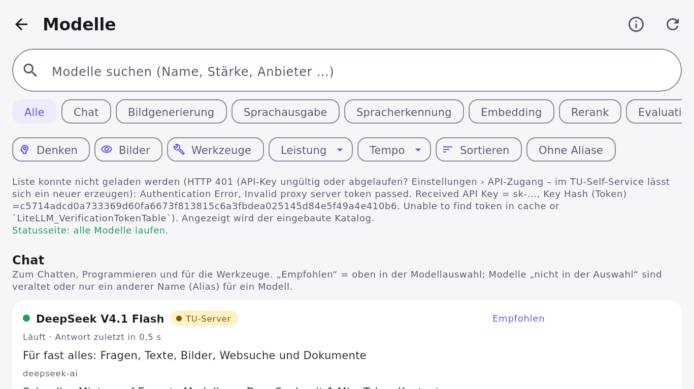 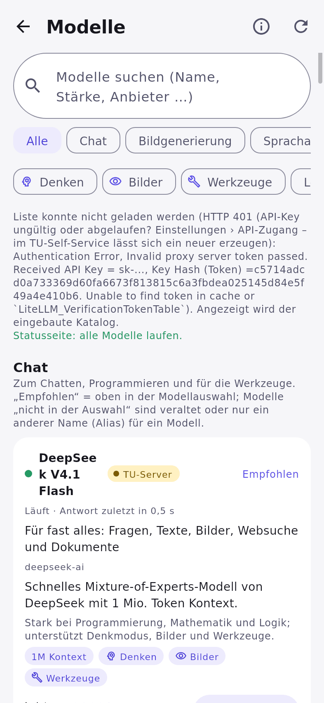 | `ModelsScreen.kt`, `Components.kt` (`CapabilityChips`) | hoch | Aufgabe als `Segmented` (Chat · Bilder · Sprache · Weitere ▾), Fähigkeiten als Filter-Menü; Karte: Name, ein Satz, drei Kennzahlen, „Chatten“. | M |
| W-12 | **Modelle auf diesem Gerät / Alles lokal einrichten**: „Schritt 1 von 9“ mit Fortschritt gut; Absätze lang; „Später“ als Link oben rechts. | `LocalModelsScreen.kt`, `LocalSetup.kt` | gering | Texte kürzen, Geräteprofil zuklappen. | S |

## E – Einstellungen

| Nr | Befund | Ort im Code | Schwere | Vorschlag | Aufwand |
| --- | --- | --- | --- | --- | --- |
| E-01 | **Übersicht** gut gegliedert (Gruppen, Symbole, Pfeile); Untertitel abgeschnitten; Namensfeld oben sehr prominent. | `SettingsOverview.kt:299` | gering | Profilzeile kompakt (Avatar, Name, „Ändern“); Untertitel zweizeilig. | S |
| E-02 | **Drei Aufbau-Muster**: Abschnitt als `GroupLabel` außerhalb (Darstellung, Transkription), Kartentitel innen (API, Lora, Datenschutz, Werkzeuge), Erklärung über den Karten (Papierkorb, Inhalte zum Nachladen). 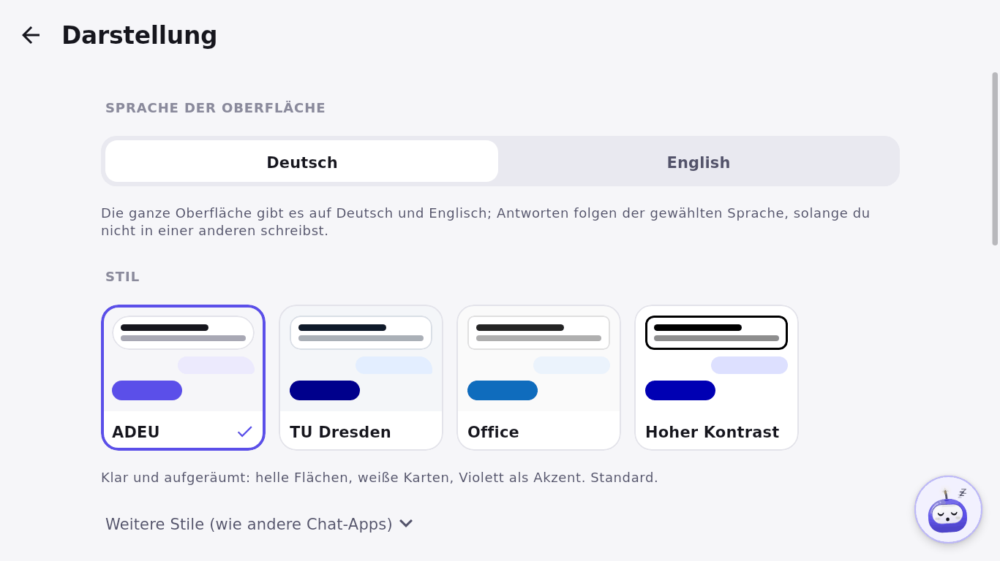 | `SettingsScreen.kt` und Seiten | hoch | Ein Muster: `GroupLabel` + Karte mit Zeilen (`SettingRow`: Titel, ein Satz, Steuerelement rechts); Erklärungen in den Untertitel. | M |
| E-03 | **Werkzeuge** als Schalterliste mit Absätzen, ohne die Symbole, die dieselben Werkzeuge in der Seitenleiste haben. 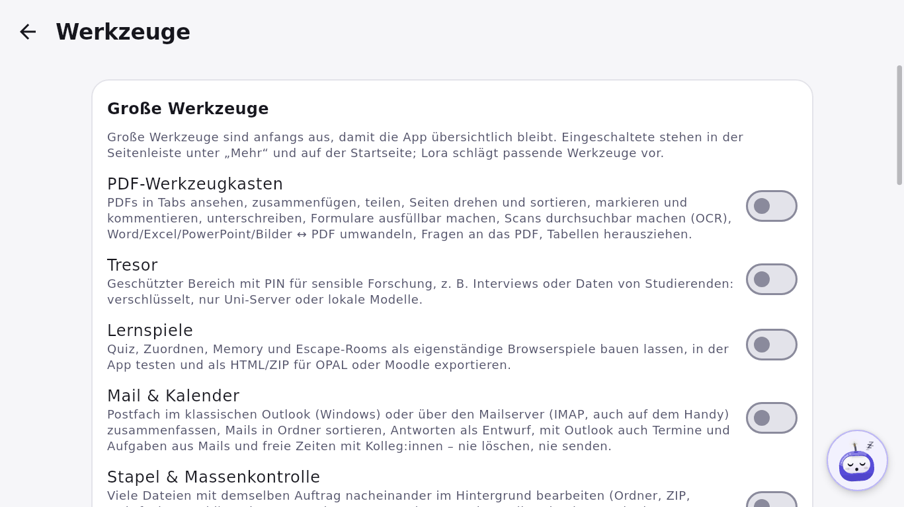 | `ToolsSettings.kt` | mittel | Kacheln mit Symbol, Name, ein Satz, Schalter; Beschreibung im Tooltip. | S |
| E-04 | **Viel Fließtext** (Gedächtnis, Speicherorte, GitHub, Verbindungen, Datenschutz). | diverse | mittel | Q-03. | M |
| E-05 | **Papierkorb leer** als zwei Karten „Keine gelöschten …“. | `BackupUi.kt` (`TrashSection`) | gering | `EmptyState`. | S |
| E-06 | **Problem melden**: Fehlerprotokoll roh und lang sichtbar. | `HelpScreen.kt` | gering | Zugeklappt mit Anzahl. | S |
| E-07 | **Updates**: URL als Fließtext. | `UpdatePrompt.kt` (`UpdateSection`) | gering | Link-Knopf „Alle Versionen“. | S |
| E-08 | **Inhalte zum Nachladen**: „Laden“ umrandet, „Öffnen“ als Text-Link in einer Liste. | `VocabularyUi.kt` (`DownloadsSection`) | gering | Q-13. | S |
| E-09 | **Datenschutz** dicht; Statuszeile „Aktiv: Regeln · Namen automatisch · …“ schwer zu lesen. | `PrivacySettings.kt` | mittel | Status als drei Marken; Abschnitte zuklappbar (gibt es teilweise). | S |
| E-10 | **Darstellung**: Stil-Kacheln gut; Vorschau zeigt nur Striche. | `AppearanceSettings.kt` | gering | Mini-Vorschau mit echter Seitenleiste und Karte. | S |
| E-11 | **Fehler am Feld** (API-Key, Token testen): Ergebnis erscheint als Banner statt am Feld – im Bild nicht auslösbar, laut Code `Notices`. | `SettingsScreen.kt` (`ApiSection`) | mittel | Ergebnis unter dem Feld (`supportingText`, Farbe + Symbol). | S |

## D – Dunkel, Hoher Kontrast, Handy, Tastatur

| Nr | Befund | Ort im Code | Schwere | Vorschlag | Aufwand |
| --- | --- | --- | --- | --- | --- |
| D-01 | **Dunkles Design** gleichwertig; Ausreißer sind die festen Farben (Q-06) und der rosa „Aufnehmen“-Knopf (dunkelrot). | – | mittel | Q-06, Q-07. | – |
| D-02 | **Hoher Kontrast**: Kontext-Chips grau auf grau, TU-Server-Marke gelb auf hellgelb, Ordner dunkelblau auf Schwarz, Dateien-FAB blau auf Schwarz – unter AAA.  | `ChatComposer.kt:77`, `DriveScreen.kt` | hoch | Kontrast-Test für alle Bilder des Reviews: misst Text gegen Grund in Kontrast-Stilen (≥ 7 : 1) und meldet Ausreißer. | M |
| D-03 | **TU Dresden** als App-Stil: sauber, unterscheidet sich von ADEU fast nur im Akzent. CD-Farben bleiben unverändert; die Oberfläche gewinnt mit allen anderen Paketen mit. | `Theme.kt` (`AppStyle.TUD`) | gering | Nichts am CD; nur die Oberfläche (Zonen, Abstände) wie überall. | – |
| D-04 | **Handy**: Brüche in Erstellen (I-07), Modelle (Q-17), Filter abgeschnitten (Q-14), Eingabeleiste gekürzt (C-06), Ecke unten rechts doppelt belegt (Q-10). Seitenleiste und Startseite am Handy sind gut. 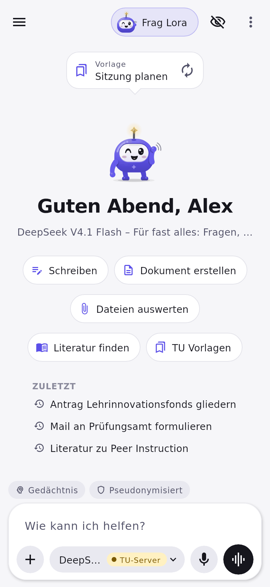 | – | hoch | Eigenes Paket mit Handy-Breite und Schrift 200 % im Look-Test. | M |
| D-05 | **Kleine Fenster** (Minimum 420 × 560): wie Handy-Breite; Seitenleiste als Overlay ok. | `Main.kt` (`minimumSize`) | – | Mit D-04. | – |
| D-06 | **Tastatur**: Fokus sichtbar (AP-30), Strg+K, Kürzel-Übersicht da. Kürzel stehen aber kaum in Tooltips und Menüs (z. B. „Neuer Chat“ ohne Strg+N, Seitenleiste ohne Strg+B); am Gerät offen aus AP-123: Tooltips, Enter/Esc in echten Dialogen, Hoher Kontrast mit Screenreader. | `Controls.kt` (`IconButton`), `AppDrawer.kt`, `ChatScreen.kt` | mittel | Kürzel im Tooltip-Text und rechts in Menüs (`DropdownMenuItem trailing`); Prüfung am Gerät. | S |

---

## Nachtrag: Abgleich mit echten Fenstergrößen (13.11.2026)

**Anlass**: Der Hauptnutzer sieht am PC (Windows, macOS, Linux) einiges nicht, was die Bilder zeigen, z. B. ist die
Willkommenskarte bei ihm nicht abgeschnitten. Nachgeprüft mit `DesignReviewTest.sizes` (gleiche Zustände in fünf
Fenstergrößen, Inhaltsfläche ohne Titelleiste und Taskleiste):

| Fenster | Inhalt (dp) | Seitenleiste | Willkommenskarte ohne Schlüssel | Gestalten-Editor |
| --- | --- | --- | --- | --- |
| 1366 × 768 bei 150 % (Review-Maßstab) | 911 × 450 | nur Overlay | fast alles abgeschnitten | „Exportieren“ senkrecht |
| 1920 × 1080 bei 150 % | 1280 × 650 | da | unteres Drittel fehlt | „Expo/rti/ere/n“ umgebrochen |
| **Standardfenster der App** (1180 × 820) | 1180 × 790 | da | unteres Viertel fehlt | „Exportieren“ rechts abgeschnitten |
| 1366 × 768 bei 100 % | 1366 × 690 | da | untere Hälfte fehlt | – |
| 1920 × 1080 bei 125 % | 1536 × 790 | da | unteres Viertel fehlt | – |

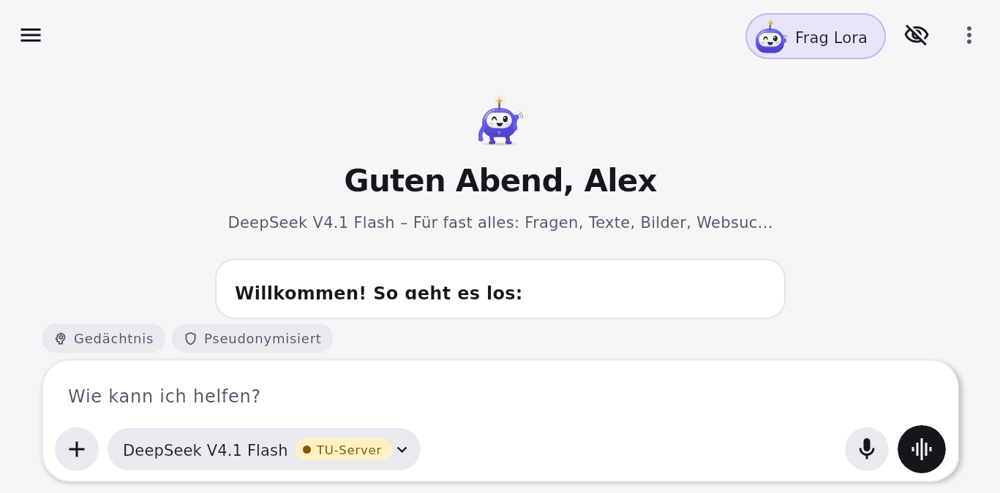
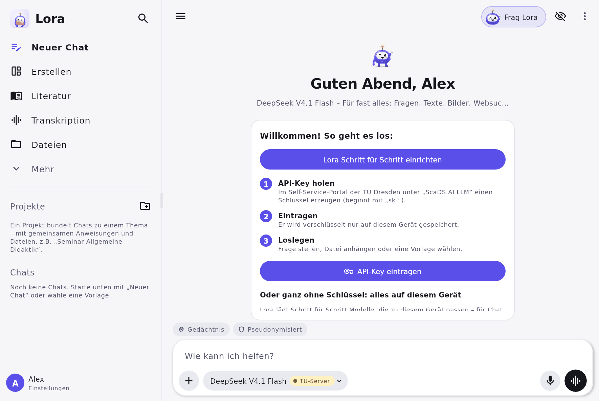
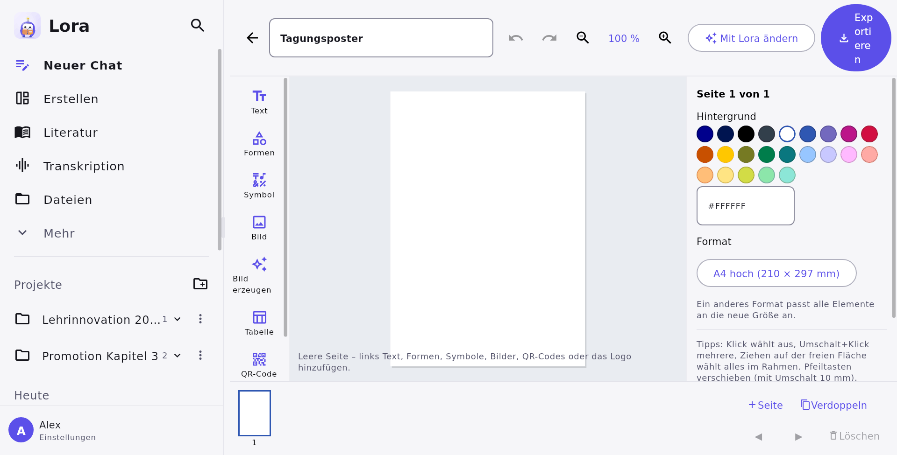

**Warum die Bilder anders aussehen als am PC des Hauptnutzers**
1. **Fenstergröße.** Das Review hat den Maßstab des Design-Arbeitsplans genommen: 1366 × 768 bei 150 % = 911 × 512 dp.
   Die App öffnet aber mit 1180 × 820 dp, und auf einem großen Bildschirm (z. B. 1920 × 1080 bei 100 % maximiert,
   ≈ 1920 × 1000 dp) ist alles noch größer. Viele „abgeschnitten“-Befunde gibt es nur im kleinen Fenster.
2. **Unsichtbares Abschneiden.** Die Willkommenskarte passt erst ab rund 950 dp Fensterhöhe ganz hinein. Darunter
   schneidet die Karte ihren Inhalt unten ab, **ohne Bildlauf** – ihr Rahmen und die runden Ecken bleiben aber
   vollständig. Sie sieht also fertig aus, es fehlt nur der Teil „Oder ganz ohne Schlüssel: alles auf diesem Gerät“
   mit seinem Knopf. Das fällt nicht auf, wenn man den Inhalt nicht kennt.
3. **Testrechner auf Englisch.** Der Testrechner läuft mit Sprache `en_US`; daher das US-Datum. Auf einem deutschen
   System zeigt die App das deutsche Datum.
4. **Beispieldaten.** Der Test nutzt einen Beispielschlüssel; deshalb die Fehlermeldung „HTTP 401“ in Modelle, und der
   Datenordner liegt unter `/tmp/…`.
5. **Handy-Breite** ist die Desktop-Oberfläche, schmal gerendert – nicht die Android-App mit ihrer eigenen Navigation.
6. **Schrift**: Der Test rendert mit Inter (Standard auf dem Testrechner), Windows mit Segoe UI, macOS mit SF – ähnlich
   breit, das erklärt höchstens einzelne Zeilenumbrüche.

**Korrekturen an den Befunden**
- **Bestätigt bei üblichen Größen**: I-10 Gestalten-Editor (schon bei 1920 × 1080 bei 150 % und im Standardfenster mit
  Seitenleiste) – bleibt *hoch*. C-02 Willkommenskarte – bleibt *hoch*, aber genauer: unter ≈ 950 dp Höhe fehlt
  unsichtbar der untere Teil (im Standardfenster das letzte Viertel).
- **Nur im kleinen Fenster (< 1000 dp breit oder < 600 dp hoch)**: C-01 (Startseite fast leer), R-01 (Seitenleiste nur
  als Overlay), R-09 (Lora-Panel als Blatt), I-11 (wenig Schreibfläche im Dokument-Editor). Schwere hängt davon ab, ob
  so kleine Fenster vorkommen – Entscheidung des Hauptnutzers (siehe unten).
- **Nur in Handy-Breite**: I-07, Q-17 (Teil Modelle), C-06, C-08, I-06 (Teil Handy), D-04 – gehören zu APD-13.
- **Testartefakte**: Q-09 US-Datum → *gering*, gilt nur, wenn die App-Sprache von der Systemsprache abweicht (z. B.
  Englisch eingestelltes Windows mit deutscher App). Q-08 Rohfehler → *mittel*, erscheint nur bei ungültigem Schlüssel,
  dann aber genau so. I-03 Pfad → bleibt ein roher Pfad, aber in der Praxis `C:\Users\…\Dokumente\Lora` statt `/tmp/…`.
- **Unabhängig von der Größe** (gelten für alle): Einheitlichkeit von Seitenkopf, Hauptaktion und leeren Zuständen
  (Q-01, Q-02), Textwüsten (Q-03), feste Farben und Kontrast (Q-06, D-02), Rot für Nicht-Fehler (Q-07), Lora ohne Regel
  (Q-19), Erstellen überladen (I-08), Whiteboard-Leisten (I-13), PDF-Start (W-01), Einstellungen (E-02) usw.

**Offene Frage an den Hauptnutzer**: Welche Bildschirme und Skalierungen sind im Alltag üblich? Der Design-Arbeitsplan
sagt „1366 × 768 bei 150 % muss gehen“; gemeint war womöglich 1920 × 1080 bei 150 % (1280 × 720 dp, häufig bei
Notebooks). Danach richtet sich, wie hoch C-01, R-01, R-09 und I-11 eingestuft werden.

---

## Grenzen dieses Reviews

- **Nicht im Bild**: Arbeitskarte und Übergabe-Karte (brauchen einen laufenden Agenten), Browser neben dem Chat (JCEF),
  Persona/System-Prompt-Dialog, Chat-Menüs, Hinweis-Banner und Update-/Fehlerdialoge (Bilder aus AP-123 in
  `docs/bilder/bedienung-*.png`), Touren, Transkript-Ansicht (die Spracherkennung fehlt auf dem Testrechner), Mail mit
  verbundenem Postfach, Android-eigene Navigation. Diese Stellen werden in den jeweiligen Paketen bebildert.
- **Am Gerät offen** (aus AP-123): Tooltips mit Maus, Enter/Esc in echten Fenstern, Bildlaufleisten, Screenreader im
  Hohen Kontrast, Schrift 200 % auf Android.
- Ein Bild zeigt den Ruhezustand: Hover, Fokus und Bewegung sind nur am Code bewertet.

---

## Stilrichtung: „Klar, ruhig – mit Lora als Farbe“

Die Oberfläche wird ruhig, hell und präzise; Farbe kommt von Lora, vom Akzent für Handlungen und von gedämpften
**Bereichsfarben** als visuelle Anker. Kein Comic-Stil, keine Verläufe, keine Effekte – die Qualität kommt aus klarer
Gliederung, sauberen Abständen und guter Typografie. Lora bleibt poppig und steht genau deshalb gut davor.

| Thema | Regel |
| --- | --- |
| **Zonen** | Drei Flächen: Seitenleiste (eine Stufe dunkler), Inhalt (hell, „Blatt“), schwebende Ebene (Menüs, Dialoge, Eingabefeld mit weichem Schatten). Kopfhöhe überall 56 dp. |
| **Formen** | Drei Radien je Stil: S = 8 dp (Felder, kleine Chips), M = 12 dp (Karten, Listenzeilen beim Hover), L = 20 dp (Dialoge, große Flächen); Pillen nur für Knöpfe und Chips. Rahmen 1 dp statt Schatten; Schatten nur für Schwebendes. In Office/Kontrast kleiner wie heute. |
| **Farbe** | Ein Akzent je Stil (ADEU Violett) **nur für Handlung und Auswahl**. Zustandsfarben fest mit Symbol: Info blau, Erfolg grün, Warnung bernstein, Fehler rot. **Bereichsfarben** gedämpft (12 % Fläche, 100 % Symbol): Chat violett, Dateien blau, Literatur petrol, Transkription koralle, Erstellen pflaume, PDF rot, Mail ocker, Werkzeuge schiefer – als Kachel vor Bereichen, Listen und Seitenköpfen. Keine festen Hex-Werte in Bildschirmen. TU-Dresden-Stil nimmt die CD-Farben unverändert. |
| **Schrift** | Skala 12 · 14 · 16 · 20 · 24 · 32 sp: Hinweis · Text · Text groß/Kartentitel · Abschnitt groß · Seitentitel · Begrüßung. Gewichte: 400 Text, 600 Titel. Abschnitte als `GroupLabel` (12 sp, Großbuchstaben, gesperrt). Ziffern tabellarisch. Zeilenlänge ≤ 80 Zeichen. |
| **Abstände** | 4er-Raster: 4 · 8 · 12 · 16 · 24 · 32 · 48. Karteninnenabstand 16 (dicht) / 20 (luftig), zwischen Karten 12, zwischen Abschnitten 24–32. |
| **Seitenkopf** | Titel 24 sp + Untertitel (ein Satz) + rechts **ein** gefüllter Hauptknopf und Symbol-Knöpfe; darunter optional Reiter/Segmente in Inhaltsbreite. Lora als „Frag Lora“-Pille im Kopf, nicht schwebend. |
| **Listen** | Zeile 48–56 dp: Kachel (Bereichs-/Dateityp-Farbe), Titel, Metazeile (relatives Datum, Ort), Aktionen erst bei Hover/Fokus, Rechtsklick-Menü. |
| **Karten** | Weiß, Rahmen 1 dp, Radius M; Kartentitel 16/600, ein Satz, Steuerelement rechts. Karten nur, wo etwas zusammengehört – keine Karte um einen einzelnen Satz. |
| **Leere Zustände** | Lora in passender Pose (96 dp) + Titel + ein Satz + Hauptknopf + Nebenknopf; zentriert in Lesebreite. |
| **Hinweise** | `StatusBanner` mit Symbol, ein Satz, eine Aktion; Fehler mit „Details“ zugeklappt. |
| **Symbole** | Material Symbols Outlined, 20 dp in Listen, 24 dp im Kopf, einheitliche Strichstärke; Bereichssymbole immer gleich (Seitenleiste = Kopf = Strg+K = Einstellungen › Werkzeuge). |
| **Bewegung** | 150–200 ms, sanft auslaufend; Oberfläche ruhig, Lora lebendig; *Ruhigere Bewegungen* schaltet beides herunter. |
| **Lora** | Startseite, Panel, Einrichtung, leere Zustände, Erfolg, Hilfe – drei Größen (32 / 96 / 160 dp). Nicht als Modell-Avatar, nicht schwebend über Inhalt. |

**Entwürfe** (HTML, noch nicht in der App) in [`entwuerfe/`](entwuerfe/), jeweils bei 1366 × 768 @ 150 % – also
genau dort, wo die App heute am schwächsten ist:

| Entwurf | Zeigt | Bild |
| --- | --- | --- |
| [Chat-Startseite](entwuerfe/chat-start.html) | Seitenleiste dauerhaft (R-01), Zonen (Q-15), Lora groß neben dem Gruß (C-01), Eingabefeld mit Status-Symbolen statt grauer Chips (C-04), Startaktionen mit Bereichsfarben, „Weiter, wo du warst“ | 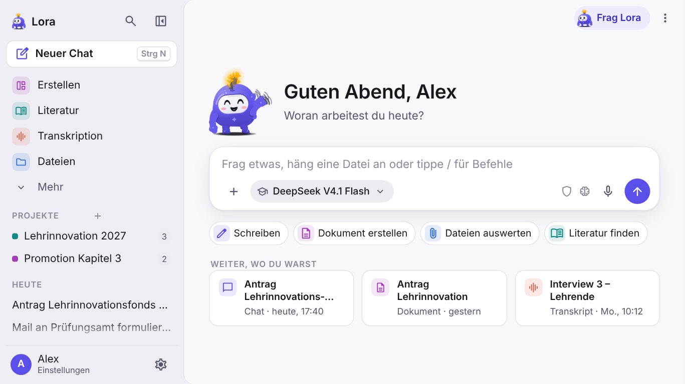 |
| [Chat-Startseite dunkel](entwuerfe/chat-start-dunkel.html) | dieselben Tokens im dunklen Design | 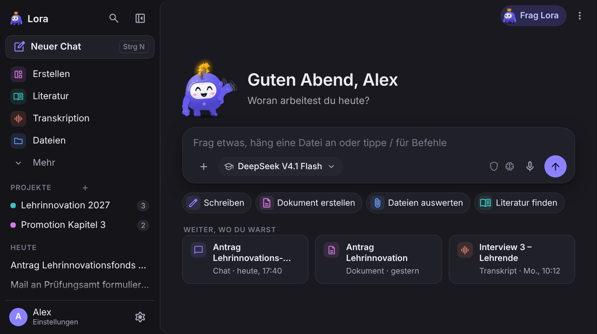 |
| [Seitenleiste mit Chat](entwuerfe/seitenleiste.html) | „Neuer Chat“ als Knopf mit Kürzel (R-03), kompakte Zeilen (R-02), Projekte mit Farbe und Zähler (R-04), `GroupLabel` (R-05), Titel mit Projekt-Pfad (C-09), neutrales Modell-Symbol (C-07), Loras Vorschläge als eigene Zeile, schmales Eingabefeld (C-05) | 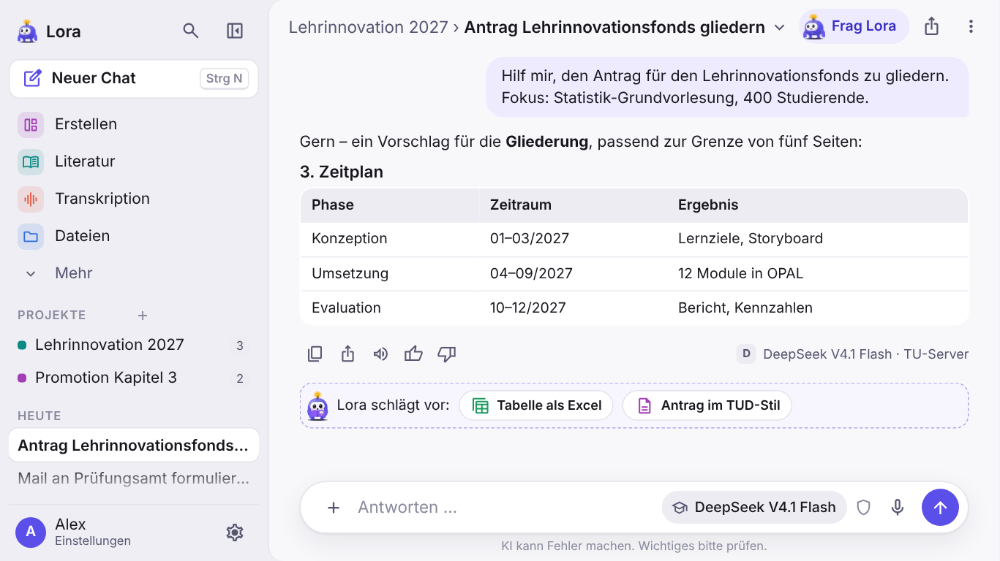 |
| [Dateien](entwuerfe/dateien.html) | Seitenkopf mit Suche und **einem** Hauptknopf (Q-01), Ort statt Pfad (I-03), Abschnitte als Reiter, „Zuletzt“ als Karten mit Vorschau, Liste mit Typ-Kacheln, Spalten, relativem deutschen Datum und Aktionen bei Hover (I-01, Q-09) | 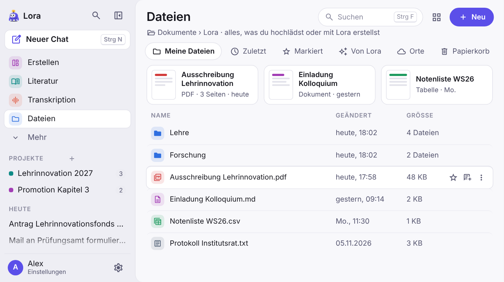 |
| [Baukasten](entwuerfe/baukasten.html) | Bereichsfarben, Knopf-Hierarchie, Schrift-Skala, Radien, Abstände, `StatusBanner`, `PageScaffold`, Listen- und Einstellungszeile, `EmptyState` mit Lora | 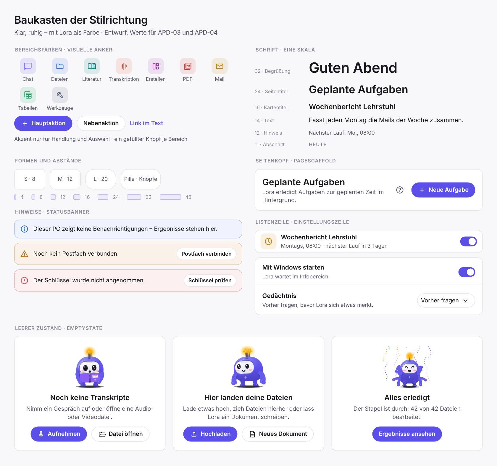 |

Neu erzeugen: `python3 docs/design/entwuerfe/erzeugen.py`, Bilder mit `node docs/design/entwuerfe/bilder.js baukasten:1120:1050`.
Lora in den Entwürfen ist die echte Figur aus `LoraFigure` (Test `DesignReviewTest.loraForDrafts`).

---

## Zuordnung zu den Paketen (APD-02 ff.)

| Paket | Befunde |
| --- | --- |
| APD-02 Sofort-Korrekturen | Q-08, Q-09, Q-17, C-02, I-07, I-10, W-05 (Teil), Q-07 (Teil: rote Zustände) |
| APD-03 Stil-Grundlagen | Q-05, Q-06, Q-11, Q-15, Q-16, Q-19 (Regel), D-02 (Kontrast-Test) |
| APD-04 Baukasten für Seiten | Q-01, Q-02, Q-03 (Muster), Q-04, Q-07, Q-12, Q-13, Q-14, Q-18 |
| APD-05 Chat-Startseite und Eingabefeld | C-01, C-03, C-04, C-05, C-06, C-09, R-10 |
| APD-06 Seitenleiste, Rahmen und Lora im Kopf | R-01 bis R-09, R-11, Q-10, Q-15 |
| APD-07 Dateien | I-01 bis I-06 |
| APD-08 Einstellungen aus einem Guss | E-01 bis E-11, Q-03 (Texte) |
| APD-09 Werkzeug-Startseiten und leere Zustände | W-01 bis W-10, W-12, I-15 |
| APD-10 Erstellen und Editoren | I-08, I-09, I-11 bis I-14 |
| APD-11 Literatur und Modelle | I-16, W-11 |
| APD-12 Chat-Antworten und Nebenansichten | C-07, C-08, C-11, C-12, Q-19 (Umsetzung) |
| APD-13 Handy, kleine Fenster, große Schrift | D-04, D-05 |
| APD-14 Kontrast, dunkles Design und Tastatur | D-01, D-02, D-06, R-07, R-08 |

Beschreibung, Reihenfolge und *Fertig, wenn* der Pakete: [Design-Arbeitsplan › Danach](../DESIGN-ARBEITSPLAN.md#danach).
